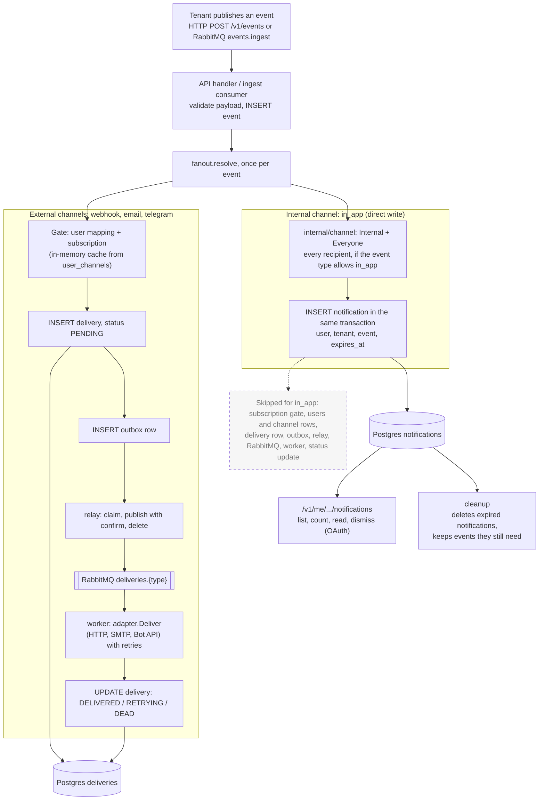

# Synapse Architecture

Synapse is an internal event fan-out and notification system for MetaBrainz. Internal services publish events; Synapse fans them out to subscriber channels — webhooks, Telegram, and more — with at-least-once delivery guarantees.

---

## Data flow

```
Internal service
      │
      │  publish (tenant_id, event_type, recipients[], payload)
      ▼
RabbitMQ  events.ingest  queue
      │
      │  consume (batch)
      ▼
cmd/ingest  ──── one transaction ────▶  Postgres
                                        ├── events
                                        ├── notifications    (in-app: one row per recipient, written directly)
                                        ├── deliveries       (external channels: one row per subscription)
                                        └── outbox           (one row per delivery)
                                               │
                                               │  poll FOR UPDATE SKIP LOCKED
                                               ▼
                                          cmd/relay  ── publish + confirm ──▶  RabbitMQ deliveries.{type}
                                                                                        │
                                                                                        │  consume
                                                                                        ▼
                                                                                   cmd/worker ──▶  Channel adapter (webhook / telegram / …)
```

Events can also arrive over HTTP (`POST /v1/events`); the API handler runs the same transaction. Internal channels (in-app) stop at the `notifications` row: they have no outbox row, queue or worker. Users then read them through the API. See [In-app notifications](#in-app-notifications).

---

## Services

### `cmd/api` — Management plane

Serves two authentication surfaces:

**Surface A — tenant API key** (`/v1/events`, `/v1/events/{id}/deliveries`): internal services publish events and query delivery status. Auth is an O(1) map lookup against the static registry loaded at startup — no DB or cache involved. Routes are rate-limited per tenant via a Redis token bucket.

**Surface B — MetaBrainz OAuth token** (`/v1/me/`*): end-users manage their own channels and subscriptions, read their in-app notifications (`/v1/me/tenants/{tenant}/notifications`, `/v1/me/notifications`) and change their preferences (`/v1/me/preferences`). Each request introspects the bearer token against the MB OAuth endpoint, and the token needs a restricted Synapse scope: `synapse:notifications:inbox` for the notification routes and streams, `synapse:notifications` for everything (403 `insufficient_scope` otherwise); results are cached in Redis (TTL = min(token expiry, 15 min)) to keep the MB endpoint off the hot path.

**Stream routes** (`/v1/stream/`*): browser event streams for the inbox. They take the same OAuth token as Surface B, checked per route after CORS so an allowed page can read a 401, and answer the CORS preflight the `Authorization` header triggers. See [Live updates](#live-updates).

### `cmd/ingest` — Ingest consumer

Bridges the RabbitMQ ingest queue to the Postgres outbox. This is the high-throughput write path.

- Collects up to `batch_size` messages per transaction.
- Each transaction: `events.InsertBatch` → `deliveries.InsertBatch` → `outbox.InsertBatch` — three tables in one commit.
- Subscription lookup uses an in-memory cache (see below), not a live DB query per event.

### `cmd/relay` — Outbox relay

Bridges the Postgres outbox to RabbitMQ. Exists because you cannot atomically commit to Postgres and publish to RabbitMQ in one transaction. See [relay.md](relay.md) for the full tick protocol.

### `cmd/worker` — Delivery worker

Consumes from the RabbitMQ `deliveries.{type}` queue and dispatches to the target system via the channel's adapter. Each channel type has its own queue, its own adapter implementation, and its own pool of worker goroutines. Adding a new connector means adding an adapter sub-package and one line in the registry — no other changes needed. See [worker.md](worker.md) for the per-message handler logic.

### `cmd/cleanup` — Housekeeping job

Runs periodically (or once via cron) to prune stale data:

- Marks `PENDING`/`RETRYING` deliveries stuck beyond their age threshold as `DEAD`.
- Deletes notifications past their `expires_at`, in batches (`--expired-batch`).
- Deletes events older than `--event-age` that nothing still needs: no notification references them and no delivery is `PENDING` or `RETRYING`.
- Drops delivery partitions older than `--event-age`, except any that still hold a `PENDING` or `RETRYING` row.
- Resets `PUBLISHING` outbox rows stuck longer than 5 minutes back to `PENDING`.

---

## Static registry

Tenant configuration (API keys, allowed event types, and which channel types each event type may fan out to) is defined as Go code and loaded at startup into an in-memory map. There is no DB lookup for tenant auth or event-type validation — resolution is an O(1) map access.

Adding a new tenant or event type requires a code change and a redeploy. This is intentional: tenants are internal services, not external customers.

---

## Three-gate fanout

When the ingest consumer processes an event, three conditions must all pass for a delivery to be created:

1. **Tenant-channel mapping** (`user_tenant_channel_mapping`) — has the user assigned an active channel of that type for this tenant?
2. **Event subscription** (`user_event_subscriptions`) — has the user subscribed to this event type on that channel type? Subscriptions can be exact (`listen`) or wildcard (`*`, matching every event type from that tenant).
3. **Static registry** — is the `(tenant_id, event_type, channel_type)` combination declared in config? Applied last as a safeguard against stale cache entries referencing channel types removed from config.

Channels that are enabled for everyone (in-app) do not go through gates 1 and 2: fan-out adds one result per recipient for each such channel the event type allows, regardless of mappings, subscriptions or a `users` row. The registry still applies, because the event type must list the channel in `AllowedChannels()`. See [In-app notifications](#in-app-notifications).

Gates 1 and 2 are resolved together in a single SQL JOIN (or an in-memory cache lookup). Gate 3 is applied by the fanout layer via `filterAllowed` after the lookup returns. The subscription cache (below) holds gates 1 and 2 in memory.

---

## Subscription cache

The ingest consumer resolves user subscriptions against an **in-memory cache** rather than querying Postgres per event. This keeps the DB out of the hot ingest path.

- On startup: full table scan populates the cache (`subscriptions.ListAllForCache`).
- On subscription change: Postgres sends a `NOTIFY subscription_changes`. The cache rebuilds immediately on receipt.
- Periodic rebuild every 30 s as a safety net in case a notification is missed.
- The LISTEN connection uses a **direct Postgres DSN** (bypassing PgBouncer), because PgBouncer transaction mode drops session-level `LISTEN` state between checkouts.
- The cache maintains two maps: `exact` (keyed by `tenantID:userID:eventType`) for specific subscriptions, and `wildcard` (keyed by `tenantID:userID`) for `*` subscriptions. Exact lookups are O(1); wildcard lookups are O(n) over the user's wildcard entries — acceptable because users won't have thousands of them.

---

## RabbitMQ topology ([infra.md](infra.md))

```
Exchange: deliveries        (topic) — main dispatch
Exchange: deliveries.retry  (topic) — TTL holding area (per-message expiration)
Exchange: deliveries.dead   (topic) — permanent failures

Per channel type (e.g. "webhook", "email", …):
  Queue: deliveries.{type}        → main queue   (DLX: deliveries.dead)
  Queue: deliveries.{type}.retry  → retry queue  (DLX: deliveries, routes back on TTL)
  Queue: deliveries.dead.{type}   → dead-letter  (manual inspection)

Exchange: events.ingest  (direct) — ingest queue
Queue:    events.ingest
```

New channel types get their own queue set automatically at startup — adding a connector requires no topology changes.

---

## Channel adapters

Each channel type is implemented as an adapter sub-package under `internal/adapter/`. All adapters satisfy the same `Adapter` interface (`Deliver`, `MaxAttempts`). Optional interfaces extend behaviour:

- **`Starter`** — called once at startup by `adapter.Build`. Used for credential validation and webhook registration (e.g. Telegram calls `setWebhook`).
- **`RouteProvider`** — mounts adapter-owned HTTP routes into the API server at startup. Used for inbound webhooks and user-facing connect flows.

Adding a new channel type means creating a new sub-package and registering it in `adapter.Build` — no changes to the fanout, relay, or ingest layers.

### Telegram

The Telegram adapter (`internal/adapter/telegram`) delivers messages via the Telegram Bot API.

**Connect flow** — users connect their Telegram account without manually finding a chat ID:

```
User clicks "Connect Telegram" in UI
      │
      │  GET /v1/me/channels/telegram/connect
      ▼
API generates a one-time token → stores in Redis (5 min TTL)
      │
      │  returns deep link: https://t.me/BotName?start=<token>
      ▼
User opens link → taps Start in Telegram bot
      │
      │  POST /internal/telegram/webhook  (Telegram → Synapse)
      ▼
Synapse looks up token → creates user_channel row → stores channel_id in Redis
      │
      │  UI polls GET /v1/me/channels/telegram/connect/<token>
      ▼
UI shows channel as connected
```

**Message formatting** — each event type defines a message template in `internal/adapter/telegram/templates.go`. Unknown event types fall back to a plain JSON dump. Templates are compiled at startup; a bad template panics immediately rather than at delivery time.

**Webhook verification** — inbound webhook requests are validated against `X-Telegram-Bot-Api-Secret-Token`. The secret is set when registering the webhook via `setWebhook` at startup.

---

## In-app notifications

In-app notifications are an always-on channel: every recipient of an event gets one, whether or not they have an account, a channel or a subscription in Synapse. A user reads them with their MetaBrainz OAuth token.

### Channels: internal and external

`internal/channel` describes every channel type with two independent properties:

| Property | Question | Values |
|---|---|---|
| **Kind** | Where does the result live and how is it produced? | **Internal:** a record in Synapse, written by fan-out in the ingest transaction, with no delivery, outbox, queue or worker. **External:** a call to another system, handled as a delivery by a worker. |
| **Enablement** | Who gets it? | **Everyone:** every recipient of an event whose type allows the channel. **Subscribed:** only recipients with a matching subscription. |

| Channel | Kind | Enablement |
|---|---|---|
| `in_app` | Internal | Everyone |
| `webhook`, `email`, `telegram` | External | Subscribed |

Channel types not listed in `internal/channel` are external and subscribed. A channel enabled for everyone cannot be created, assigned or subscribed to (422) and is hidden from the event-type catalog. An event type produces notifications only if it lists `eventspec.ChannelInApp` in `AllowedChannels()`; every ListenBrainz event type does except `listen`, which is too high-volume for an inbox.

### Write path

Fan-out has two paths. External channels are unchanged. Internal channels write their record directly in the same transaction as the event.



- `dry_run` counts notifications as results, so `delivery_count` is the number of notifications plus deliveries.
- A recipient who has never logged in still gets notifications: no `users` row is needed.
- If the transaction rolls back, no notification is written.

### Data model

| Table | Holds |
|---|---|
| `notifications` | One row per event and recipient: `id`, `event_id`, `user_id`, `tenant_id`, `created_at`, `read_at`, `dismissed_at`, `expires_at`. The payload stays in `events`. |
| `user_preferences` | One row per user who has changed a preference: `user_id`, `cross_tenant_notifications`. No row means the defaults. |

- `notifications.event_id` references `events(id)`, so an event cannot be deleted while a notification points at it. `UNIQUE (event_id, user_id)` allows one notification per event and recipient.
- `user_id` has no foreign key to `users`: a recipient can be notified before they ever log in.
- Indexes serve the inbox (`user_id, id DESC`, per tenant and overall, for undismissed rows), the unread count, and expiry.

### Reading notifications

All routes use the user's OAuth token (Surface B). A notification that is dismissed or past its `expires_at` is never returned, whether or not cleanup has deleted it yet.

Responses return `read_at` (absent while unread); there is no separate `is_read`.

**Tenant routes**, always limited to the tenant in the path:

| Route | Purpose |
|---|---|
| `GET /v1/me/tenants/{tenant}/notifications` | Newest first. `limit` (1–100, default 25), `before_id` cursor (use `next_cursor`), `event_type`, `unread=true` |
| `GET .../notifications/unread-count` | Badge count |
| `POST .../notifications/{id}/read` | Mark one read (idempotent, keeps the original `read_at`) |
| `POST .../notifications/read-all` | Mark all of the tenant's unread notifications read |
| `DELETE .../notifications/{id}` | Dismiss (permanent) |

**Global routes** span every tenant and return 403 unless the user's `cross_tenant_notifications` preference is on:

| Route | Purpose |
|---|---|
| `GET /v1/me/notifications` | Newest first across tenants; optional `tenant_id`, `unread`, `limit`, `before_id` |
| `GET /v1/me/notifications/unread-counts` | `count` and a per-tenant `by_tenant` breakdown |
| `POST /v1/me/notifications/read-all` | Mark every tenant's unread notifications read |
| `POST /v1/me/notifications/{id}/read`, `DELETE /v1/me/notifications/{id}` | Read or dismiss any of the user's notifications |

A notification id that belongs to another user, is dismissed or has expired returns 404 on every route. The tenant routes ignore the preference and never touch another tenant's rows.

**Preferences:**

| Route | Purpose |
|---|---|
| `GET /v1/me/preferences` | `{"cross_tenant_notifications": false}`; the defaults when the user has no row |
| `PATCH /v1/me/preferences` | Changes only the fields in the body (creates the row on the first change); unknown fields are rejected (422) |

`cross_tenant_notifications` (default off) is a presentation preference, not an access control. The user's token is not bound to a tenant, so any application holding it can read any tenant's notifications through that tenant's route.

### Live updates

An open inbox learns about changes over a Server-Sent Events stream instead of polling. The stream carries only a nudge that says "refetch"; the client then reads counts and notifications from the routes above, so the API stays the only source of truth.

```
GET /v1/stream/tenants/{tenant}/notifications   Authorization: Bearer <token>   one tenant's nudges
GET /v1/stream/notifications                    Authorization: Bearer <token>   every tenant's; 403 unless cross_tenant_notifications is on
```

- **Auth:** the user's MetaBrainz OAuth token, checked by the same middleware as `/v1/me/*`. A missing or inactive token returns 401; a token with neither `synapse:notifications:inbox` nor `synapse:notifications` returns 403; a failing introspection returns 503. Clients open the stream with `fetch`, since `EventSource` can't send headers.
- **Events:** `event: inbox` with `data: {"kind": "created" | "changed", "tenant": "…"}`, and `event: ping` every 25 s to keep proxies from closing an idle stream. `created` is sent after an ingest commits a notification for the user; `changed` after the user reads, reads all or dismisses. The tenant stream drops nudges for other tenants.
- **Nudges can be dropped**, so a client also refetches when it (re)connects and when the tab becomes visible. Several nudges and one nudge mean the same thing: refetch.
- **CORS:** the response allows the request's `Origin` only if it is listed in that tenant's `tenants.<id>.stream_origins` (any tenant's for the global stream).
- **Limits:** 32 open streams per user per API instance; the 33rd gets 429. A stream closes after 15–18 minutes, so reconnecting re-checks the OAuth token (cached up to 15 minutes) and preferences. A frame that can't be written within 10 s closes the stream, so a client that stops reading doesn't hold a slot.
- **Reconnect is client-driven.** On 401 the client refreshes its token and reconnects; on any other status, a network error or a closed stream it waits a random backoff and reconnects. A Redis or hub failure before the stream starts returns 503. See [Tenant integration](tenant-integration.md#live-updates) for the client contract.

```
ingest / API mutation ── commit ──▶ PUBLISH synapse:inbox:{user_id}  (best effort, 500 ms budget)
                                          │  Redis pub/sub
                                          ▼
             each API instance: one SUBSCRIBE connection (live.Hub)
                                          │  per-user channel, subscribed while the user has a stream open
                                          ▼
                                  that user's open streams
```

- Publishing happens after the transaction commits and never fails the request or the ingest batch. Fan-outs are pipelined 1000 users at a time and stop at the first failed batch.
- Each instance subscribes to a user's channel when their first stream opens and unsubscribes when the last closes. A stream is only reported open once Redis has confirmed the subscription.
- If the hub's Redis connection fails, or stays silent through 30 s and an unanswered PING, every stream on that instance ends and its clients reconnect.
- Behind a proxy, streams need HTTP/2 (browsers allow 6 HTTP/1.1 connections per origin) and response buffering off; the stream sets `X-Accel-Buffering: no`.

**Tenant view:** `GET /v1/events/{id}/deliveries` (tenant API key) lists each notification as a `DELIVERED` result with `channel_type` `in_app`, next to the external deliveries. Read and dismissed state is not exposed to tenants.

### Expiry

Each notification gets an `expires_at` at fan-out from `tenants.<id>.in_app_retention_days` (30 days if unset). It is frozen on the row, so changing the setting affects only later notifications. Expiry applies whether or not the notification was read.

### Cleanup

`cmd/cleanup` deletes notifications and events separately, and each kind owns its own lifetime:

- **Notifications:** deleted in batches once `expires_at` has passed (`--expired-batch`, default 5000). Notification cleanup never deletes events.
- **Events:** deleted only when all of these hold: the event is older than `--event-age` (default 90 days, measured from its creation), no notification references it, and no delivery is `PENDING` or `RETRYING`. Event age is the earliest an event may be deleted; live dependents decide whether it is.
- **Delivery partitions:** an old partition is dropped only if it holds no `PENDING` or `RETRYING` delivery.

So an event lives for `max(--event-age, the longest notification expiry that references it)`. For example, with `--event-age` at 30 days and a tenant keeping notifications for 90 days, the event passes its age on day 30 and is kept because the notification still needs it. On day 90 the notification is deleted and the next run deletes the event.

Event age also bounds the deduplication window: an event row, with its idempotency key, lives at least `--event-age`, so a retried event inside that window is still recognised as a duplicate. The cost is that an event's payload stays until `--event-age` even if its notifications expired earlier.
